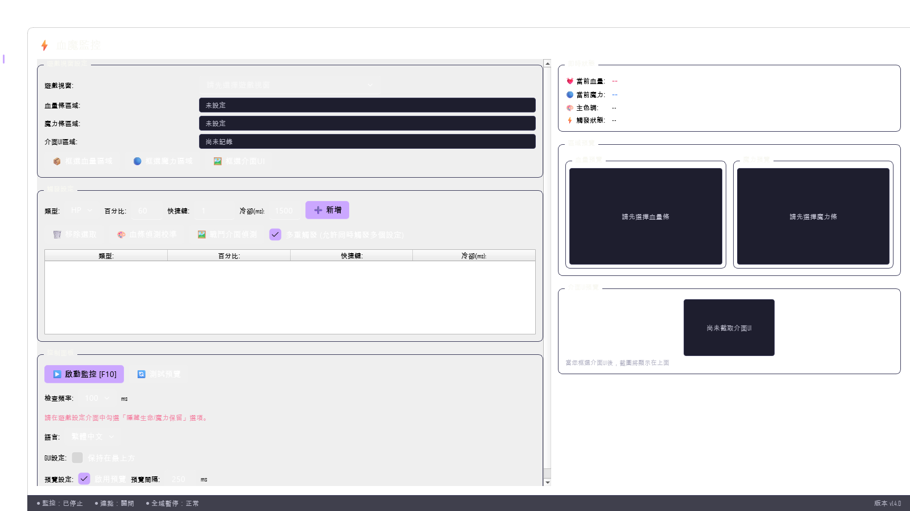
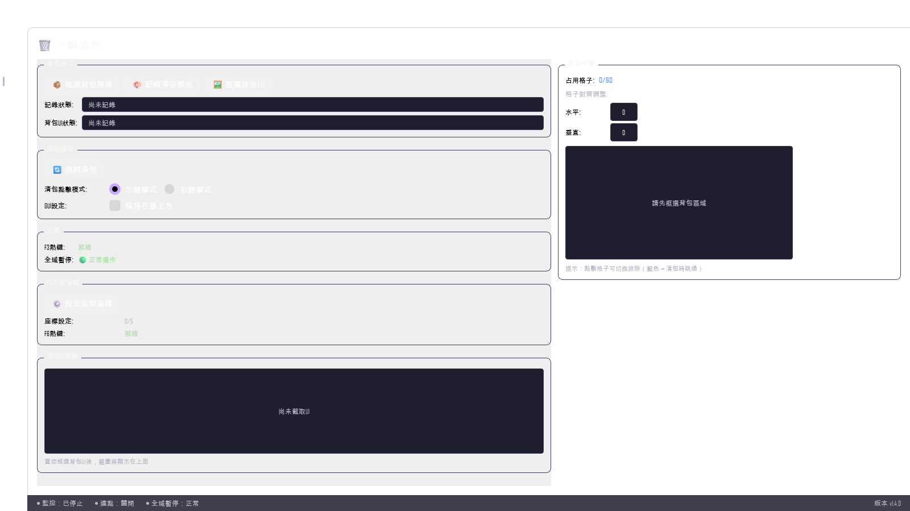
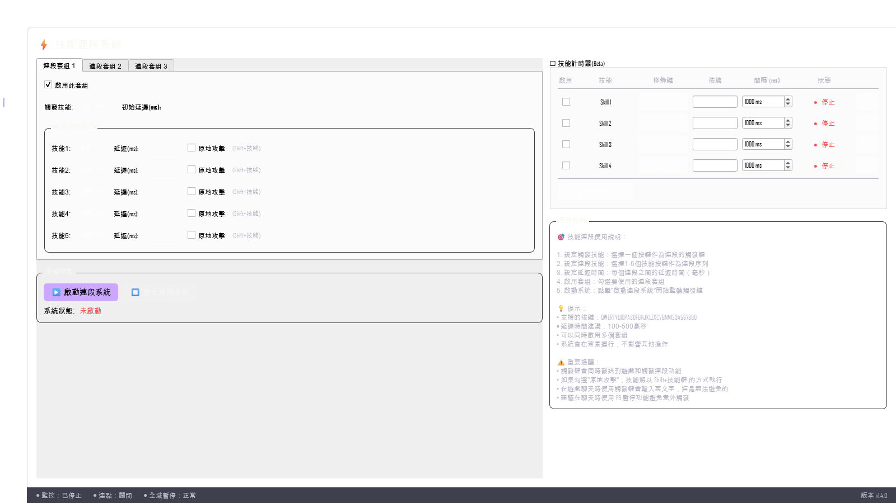
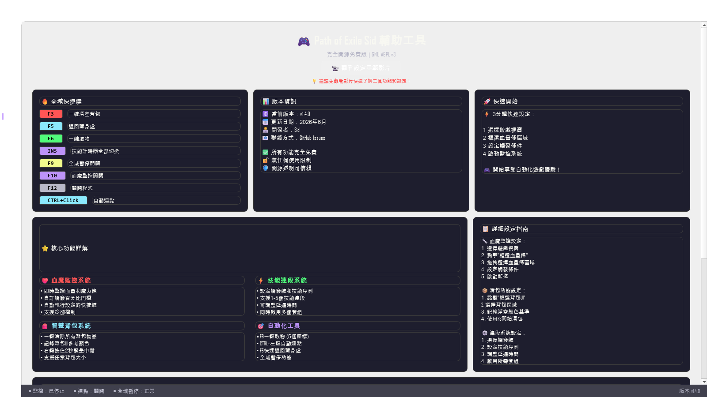
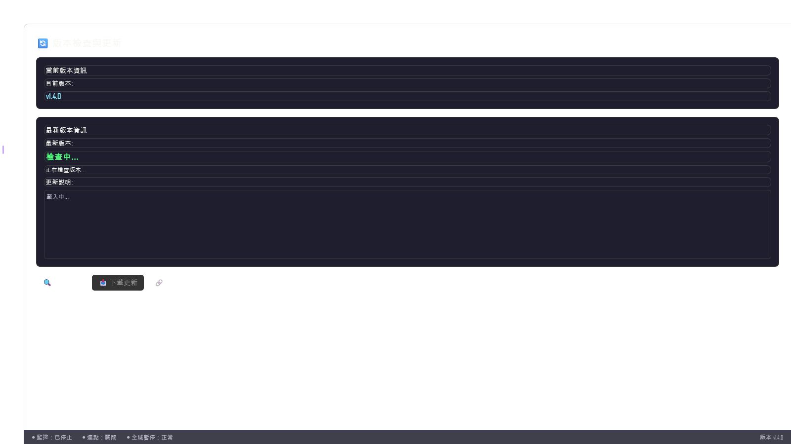
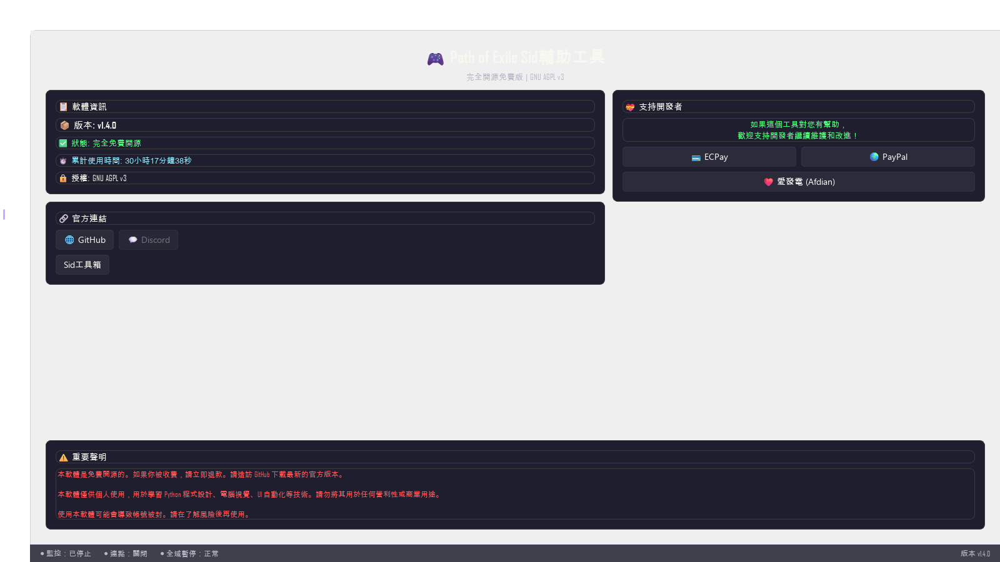
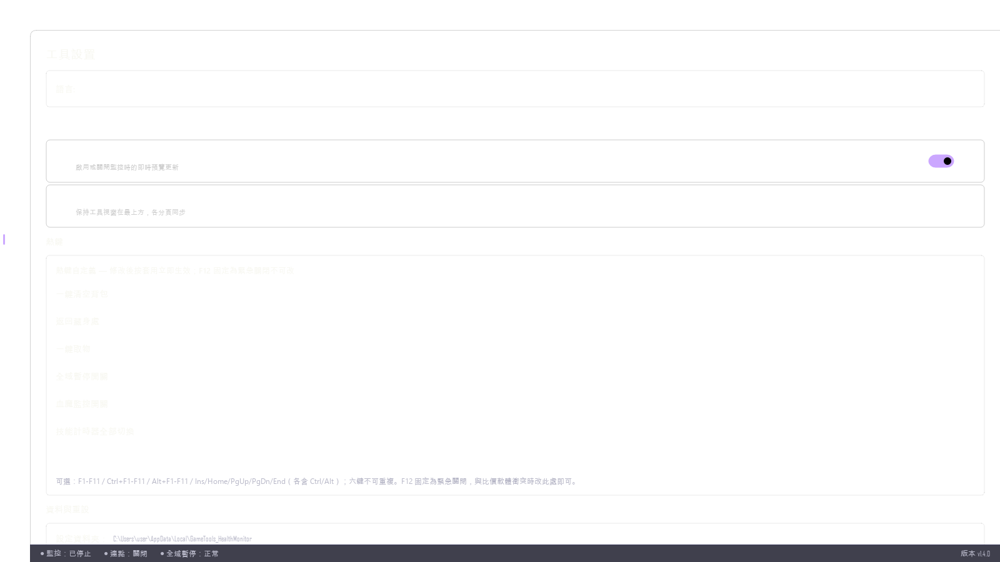

<p align="center">
  
</p>

<h1 align="center">GameTools Health Monitor</h1>

<p align="center">
  <i>Path of Exile Sid 輔助工具</i>
</p>

<p align="center">
  <a href="README.md"></a>
  <a href="README.zh-TW.md"></a>
  <a href="README.zh-CN.md"></a>
</p>

<p align="center">
  
  
  
  <a href="https://sid-1996.github.io/PathofExile-Sid-GameTools_HealthMonitor/"></a>
</p>

<p align="center">
  A Windows automation research toolkit built on image recognition and input simulation<br>
  <sub>External automation research toolkit for Path of Exile</sub>
</p>

<p align="center">
  
</p>

---

## 📹 Demo

<p align="center">
  <a href="https://www.dailymotion.com/video/xa9cau2">
    
  </a>
</p>

---

## ✨ Features

<table>
  <tr>
    <td><b>🩸 Health / Mana Monitor</b><br>Real-time percent detection · Multi-threshold triggers · Cooldown protection</td>
    <td><b>⚡ Skill Combos</b><br>Custom sequences · Adjustable delays · Multiple profiles</td>
  </tr>
  <tr>
    <td><b>🎒 Inventory Automation</b><br>One-click clear · Fixed-point pickup · UI color recognition</td>
    <td><b>🖱️ Auto Click</b><br>Toggle with Ctrl + Left Click</td>
  </tr>
  <tr>
    <td><b>⏱️ Skill Timers</b><br>Millisecond precision · Supports key combinations</td>
    <td><b>⏸️ Global Control</b><br>F9 Pause · F12 Exit</td>
  </tr>
</table>

---

## 🖼️ Screenshots

<p align="center">
  <b>Health Monitor</b><br>
  
</p>

<p align="center">
  <b>Inventory Automation</b> · <b>Skill Combos</b><br>
  <br>
  
</p>

<p align="center">
  <b>Status · Help · Version</b><br>
  
  
  
</p>

<p align="center">
  <b>About · Settings</b><br>
  <br>
  
</p>

---

## ⌨️ Hotkeys

| Key | Action |
|:---:|:---|
| `F3` | Clear Inventory |
| `F5` | Return to Hideout |
| `F6` | Pickup Sequence |
| `F9` | Pause / Resume |
| `F10` | Health Monitor Toggle |
| `F12` | Exit |
| `Ctrl + Click` | Auto Click |

---

## 📦 Download

<p align="center">
  <a class="btn" href="https://github.com/Sid-1996/PathofExile-Sid-GameTools_HealthMonitor/releases">
    
  </a>
</p>

<p align="center">
  <sub>⚠️ <b>Users on v1.2.1 or earlier must reinstall manually</b>: auto-update will fail during download. Please download <code>Sid.GameToolsHealthMonitor-win-Setup.exe</code> and install over the old version (settings are preserved) · Windows 10 / 11<br>New users: download <code>Setup.exe</code> (recommended)</sub>
</p>

---

## 🚀 Quick Start

> ⚠️ **Game window setup**: Set Path of Exile to **Windowed Fullscreen** or **Windowed** mode so background capture and overlay notices work correctly.

### Secure self-build (read first)

> With AI-driven attacks and lookalike download sites on the rise, only trust this official entry point: **https://github.com/Sid-1996/PathofExile-Sid-GameTools_HealthMonitor/releases**. Full guide for the three paths (source / self-built EXE / official package) is in [`docs/安全自建.md`](docs/安全自建.md) —— pick any one of them; this section only shows commands.

### Path A — Run from source

```powershell
git clone https://github.com/Sid-1996/PathofExile-Sid-GameTools_HealthMonitor.git
cd PathofExile-Sid-GameTools_HealthMonitor
uv sync --locked
Run.bat
```

(The legacy `scripts\install_dependencies.bat` still works, falling back to a global install.)

### Path B — Build your own EXE

```powershell
uv sync --locked
scripts\build_exe.bat
Run.bat
```

### Path C — Official package

Go to [Releases](https://github.com/Sid-1996/PathofExile-Sid-GameTools_HealthMonitor/releases) above and download `Setup.exe` (see Download section).

### Data & Reset

- Config file: `%LOCALAPPDATA%\GameTools_HealthMonitor\health_monitor_config.json` (`*.backup` auto-backup, `screenshots\` captures)
- In-app `Settings > Data & Reset` can `Open Folder / Copy Path / Reset to Default` (screenshots are kept unless you also check the delete option)

### Uninstall

- **Setup.exe install**: `Windows Settings > Apps > Installed Apps > Sid.GameToolsHealthMonitor > Uninstall`, then manually delete `%LOCALAPPDATA%\GameTools_HealthMonitor` if you want to clear screenshots/settings
- **ZIP portable**: delete the extracted folder + the data folder above

---

## 📂 Project Structure

<details>
<summary>View full structure</summary>

```
src/
  app.py                     # Qt (PySide6) entry point
  qt/                        # Qt GUI layer (main_window + 7 tabs)
  monitor_analyzer.py        # Health/mana HSV analysis + triggers
  capture_utils.py           # Screenshot + mss singleton
  image_utils.py             # Image drawing/resize/preview
  inventory_utils.py         # Inventory slot analysis
  config_manager.py          # Config load/save + backup
  language_system.py         # Translation system (zh-tw / zh-cn / en)
  utils.py                   # Runtime utilities + get_user_data_dir + F12 emergency close
  auto_click_manager.py      # Auto-click (AHK) manager
  usage_tracker.py           # Usage time tracking
  window_key_sender.py       # Window-focus key sending
  auto_update.py             # Velopack GithubSource update engine (main, >= v1.2.4-test)
  updater_core.py            # Legacy update engine (transitional, removed in v1.4+)
  language_packs.json        # UI strings
scripts/                     # One-click workflows
tools/build.py               # Build pipeline (PyInstaller onedir + sidecar resources)
docs/                        # User/developer docs
updater_main.py              # Standalone updater (Legacy, transitional)
release.ps1                  # One-click publish (stable / -Preview / -TestRepo)
```

</details>

---

## 🧠 Tech Stack

<p>
  
  
  
  
  
  
  
  
</p>

---

## 🙏 Acknowledgements

Thanks to the open source projects that let this small toolkit focus on the task itself.

- Velopack — install & update
- PySide6 / qfluentwidgets — UI
- OpenCV — image recognition
- Windows.Graphics.Capture — window capture
- AutoHotkey / PyInstaller — auto-click & packaging

Please let me know if anyone is missing.

---

## 🤝 Community

<p>
  <a href="https://www.facebook.com/talksometingshit/"></a>
  <a href="https://github.com/Sid-1996/PathofExile-Sid-GameTools_HealthMonitor/issues"></a>
  <a href="https://github.com/Sid-1996/PathofExile-Sid-GameTools_HealthMonitor"></a>
</p>

---

## ☕ Support

If my tools help you, feel free to support me in your own way.

[](https://ko-fi.com/K3K11KMXOL)
[](https://www.paypal.com/ncp/payment/GJS4D5VTSVWG4)
[](https://p.ecpay.com.tw/E0E3A)
[](https://afdian.com/a/sid-1996)

---

## ⚠️ Disclaimer

<details>
<summary>Click to view full disclaimer</summary>

This software is provided for educational research, automation study, and image recognition experimentation.

This software does NOT modify game files, inject code, or access game memory.

Usage may violate the Terms of Service of Grinding Gear Games. Use at your own risk.

</details>

---

<p align="center">
  <sub>License: <a href="https://www.gnu.org/licenses/agpl-3.0">AGPL-3.0</a> · Built with ❤️ by Sid-1996</sub>
</p>
